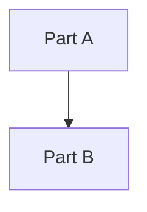

# <Feature name> — Design

As of YYYY-MM-DD · Requirements: [requirements.md](./requirements.md) · Tasks: [tasks.md](./tasks.md)

**Approval:** Waiting for review. Write only after requirements are approved.

**Labels:** _Agreed_ = decided · _Proposed_ = suggestion, not confirmed · _Open_ = not decided, ask first.

## Overview

<!-- One paragraph: how the design meets the requirements. -->

## Architecture

<!-- A Mermaid diagram of the parts and what calls what, plus one or two sentences. -->

## Decisions

| Decision | Choice | Why | Status |
| -------- | ------ | --- | ------ |
|          |        |     |        |

## Components

<!-- One row per component: what it does, what it owns, which requirements it covers. -->

| Component | Responsibility | Covers |
| --------- | -------------- | ------ |
|           |                | R1, R2 |

## Data model

<!-- Tables, columns, types. Only what this feature adds or changes. -->

## Interfaces

<!-- APIs, events, file formats. Include at least one concrete example (JSON, URL, command). -->

## Error handling

<!-- What happens on each failure the requirements mention (IF ... THEN ...). -->

## Testing

<!-- How each requirement will be checked: unit, integration, manual. -->

## Open questions

- [ ]
