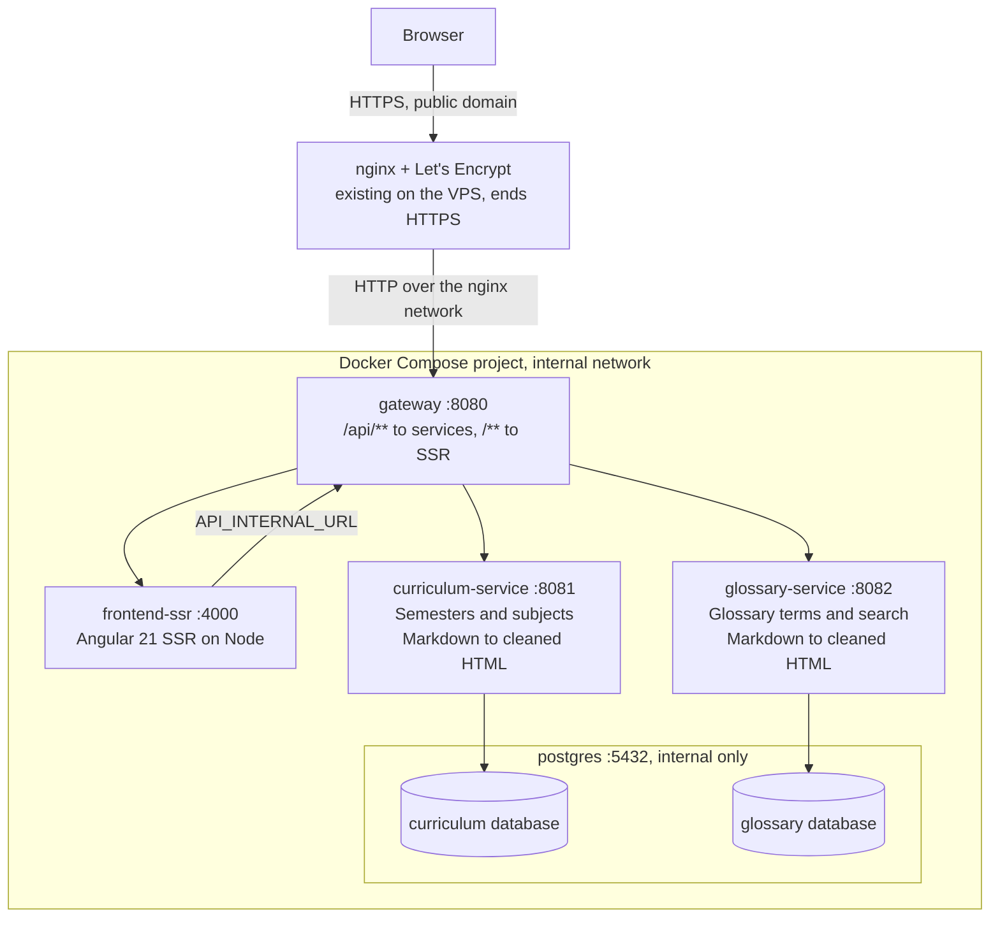

# BA.LLB Portal — Frontend/Backend Architecture Spec

As of 2026-11-04 · Living version: [Claude Doc](https://claude.ai/artifact/GKFbjVkw56ZC69nMATfcKG) — keep this file in sync when the spec changes.

**How to read this spec:** _Agreed_ means decided in discussion on 2026-11-04; _Proposed_ means Claude's suggestion, awaiting approval.

## Overview

The portal moves from a hardcoded Angular app on GitHub Pages to an Angular SSR frontend backed by Spring Boot microservices. Content lives in PostgreSQL as Markdown and is served through an API gateway, so content can change without a frontend redeploy.

**Today:** all semesters, subjects and glossary terms are TypeScript constants in `libs/curriculum/data-access` and `libs/glossary/feature`. The site is built as static files and published to GitHub Pages from the `deploy` branch.

**Goals:**

- Store all content (subjects, units, glossary) in a database, written as Markdown, in English and Hindi.
- Render pages on the server (Angular SSR) for fast first load and search-engine indexing.
- Split the backend into Spring Boot services that each own their data.
- Run the same container images in test, staging and production on a VPS behind the existing nginx + Let's Encrypt setup.
- Deploy through GitHub Actions.

## Architecture

Every request enters through nginx and the gateway; services and Postgres are reachable only on the stack's internal network.



A page load flows: browser → nginx → gateway → `frontend-ssr`, which calls the gateway at `API_INTERNAL_URL` for data, renders HTML and returns it. After hydration, the browser calls `/api/...` directly and the same path serves JSON.

## Key decisions

| Decision          | Choice                                                                                                                   | Why                                                                                                                                                                                              | Status   |
| ----------------- | ------------------------------------------------------------------------------------------------------------------------ | ------------------------------------------------------------------------------------------------------------------------------------------------------------------------------------------------ | -------- |
| Markdown to HTML  | Backend (flexmark-java), then cleaned with OWASP Java HTML Sanitizer                                                     | After the first SSR page, navigation happens in the browser; rendering in the backend keeps a Markdown parser out of the browser bundle and gives one cleaned, cacheable output for every client | Proposed |
| Rendering         | Angular SSR (`@angular/ssr`), server render mode for all routes, with hydration and the HTTP transfer cache              | Full HTML on first load for speed and SEO; data fetched during SSR is reused in the browser, not fetched twice                                                                                   | Agreed   |
| Entry point       | nginx talks only to the gateway; the gateway routes `/api/**` to services and everything else to the SSR container       | Matches the existing VPS network rule: nginx → gateway → services                                                                                                                                | Agreed   |
| SSR → API calls   | SSR calls the gateway on the internal Docker network (`API_INTERNAL_URL`); the browser calls `/api` on the public domain | Server-side calls never leave the VPS                                                                                                                                                            | Proposed |
| Data ownership    | One database per service, inside one Postgres container; schemas managed by Flyway                                       | Services stay independent without running several Postgres servers                                                                                                                               | Agreed   |
| Service discovery | None; Docker Compose DNS names (`curriculum-service:8081`)                                                               | A fixed set of services on one host does not need Eureka or Consul                                                                                                                               | Proposed |
| Bilingual content | Each response carries English and Hindi side by side; Hindi may be null and falls back to English                        | The language toggle stays instant with no refetch, as it works today                                                                                                                             | Proposed |
| Backend stack     | Spring Boot 4.0.9, Spring Cloud 2025.1.4 (Gateway, WebFlux), Java 17 baseline, Maven multi-module                        | Current stable releases; Java 17 matches the local JDK                                                                                                                                           | Proposed |
| Database          | PostgreSQL 17                                                                                                            | Mature, free, good text search for later                                                                                                                                                         | Proposed |

## Services

_Status: microservices agreed; this exact split into services is proposed._

Four application containers plus Postgres make up the stack; only the gateway joins the nginx network.

| Service              | Port                 | Owns                  | Responsibilities                                                                                                                                                          |
| -------------------- | -------------------- | --------------------- | ------------------------------------------------------------------------------------------------------------------------------------------------------------------------- |
| `gateway`            | 8080                 | Nothing               | Spring Cloud Gateway. Routes `/api/curriculum/**` and `/api/glossary/**` to services, `/**` to `frontend-ssr`. Adds request IDs and security headers; later rate limiting |
| `curriculum-service` | 8081                 | `curriculum` database | Semesters, subjects and their Markdown content. Renders Markdown to cleaned HTML and caches it (Caffeine), keyed by subject and `updated_at`                              |
| `glossary-service`   | 8082                 | `glossary` database   | Glossary terms; search by term or meaning. Renders Markdown meanings the same way                                                                                         |
| `frontend-ssr`       | 4000                 | Nothing               | Angular 21 SSR on Node. Renders pages by calling the gateway internally                                                                                                   |
| `postgres`           | 5432 (internal only) | Data files            | One database per service, each with its own user                                                                                                                          |

Every Spring service exposes Spring Boot Actuator `/actuator/health` for Docker health checks. Ports are internal; nothing but the gateway is reachable from nginx.

## Frontend

_Status: proposed._ Pages, URLs, components and the language toggle stay; what changes is where data comes from and where pages first render.

| Area               | Today                                                                                | After the change                                                                                                                                                                                                                                                |
| ------------------ | ------------------------------------------------------------------------------------ | --------------------------------------------------------------------------------------------------------------------------------------------------------------------------------------------------------------------------------------------------------------- |
| SSR setup          | Browser-only build                                                                   | `@angular/ssr` adds `server.ts` (Express), `main.server.ts`, `app.config.server.ts` and `app.routes.server.ts`. The build outputs `browser/` and `server/`; the container runs `node server/server.mjs` on port 4000                                            |
| Render mode        | Static files                                                                         | `RenderMode.Server` for every route. Content changes without a rebuild, so build-time prerendering would serve stale pages                                                                                                                                      |
| Hydration          | None                                                                                 | `provideClientHydration(withHttpTransferCacheOptions(), withEventReplay())`: data fetched during SSR is embedded in the page and reused by the browser                                                                                                          |
| Curriculum data    | `CurriculumService` reads the `CURRICULUM` constant                                  | Same service, now backed by `httpResource` calls to `/api/curriculum/...`. Models follow the API: `html` replaces `units`, `statutes`, `books` and `assessment`. The `.data.ts` files move to `tools/content-export` and leave the app                          |
| Glossary data      | `GLOSSARY` constant, filtered in the component                                       | New `libs/glossary/data-access` loads all terms once from `/api/glossary/terms` and filters in the browser, so search stays instant. Switch to server-side `?q=` if terms grow past a few hundred                                                               |
| API address        | Not needed                                                                           | Code always calls relative `/api/...`. On the server, an interceptor prefixes `API_INTERNAL_URL`; `HTTP_TRANSFER_CACHE_ORIGIN_MAP` maps that internal origin to the public one so the transfer cache still matches in the browser                               |
| Subject content    | Template loops over units and topics                                                 | Renders the backend's cleaned `html.en` or `html.hi` with `[innerHTML]` inside a styled `.prose` block. Angular's own sanitizer runs again as a second layer                                                                                                    |
| Language toggle    | Signal + `localStorage`; `tr` pipe                                                   | `tr` pipe unchanged. The choice is also saved in a `ballb.lang` cookie; the server reads it from the request and renders in that language, so Hindi readers don't see English flash first. `localStorage` and `document` access move behind `isPlatformBrowser` |
| Routes and SEO     | `/`, `/semesters`, `/semesters/:semester`, `/semesters/:semester/:code`, `/glossary` | Same URLs. Page titles use the subject title from the API; a meta description is set per page with the `Meta` service                                                                                                                                           |
| Loading and errors | Data is always present                                                               | SSR waits for data before responding. In-browser navigation shows a skeleton while loading. An unknown semester or subject shows a Not found page and SSR returns HTTP 404 (via `RESPONSE_INIT`); a failed API call shows a retry message                       |
| Base path          | `/ballb/` for GitHub Pages                                                           | `/` on the project's own domain                                                                                                                                                                                                                                 |
| Dev server         | `nx serve`                                                                           | `nx serve` with SSR; `proxy.conf.json` sends `/api` to the gateway at `http://localhost:8080`, and `API_INTERNAL_URL=http://localhost:8080` for server-side calls                                                                                               |

The portal's Nx library boundaries stay: `data-access` libraries own HTTP calls, `feature` libraries own pages, and `shared/ui` owns the language service, `tr` pipe and page header.

## Data model

_Status: Markdown in a database agreed; tables and columns proposed._

Metadata lives in typed columns; everything a student reads lives in Markdown columns, one per language. Hindi columns are nullable so translation can happen gradually.

### curriculum database

| Table             | Columns                                                                                                                                                                                                                                           | Notes                                                                              |
| ----------------- | ------------------------------------------------------------------------------------------------------------------------------------------------------------------------------------------------------------------------------------------------- | ---------------------------------------------------------------------------------- |
| `semester`        | `number` (PK, 1–10), `year` (1–5), `note_en`, `note_hi`                                                                                                                                                                                           | Notes are Markdown                                                                 |
| `subject`         | `id` (PK), `code` (unique, URL key), `semester_number` (FK), `sort_order`, `title_en`, `title_hi`, `category`, `source` (`official`/`sample`), `paper`, `optional`, `practical`, `credits`, `max_marks`, `summary_en`, `summary_hi`, `updated_at` | `code` keeps today's URLs: `/semesters/:semester/:code`                            |
| `subject_content` | `subject_id` (FK), `lang` (`en`/`hi`), `body_md`, `updated_at`; PK (`subject_id`, `lang`)                                                                                                                                                         | One Markdown document per language: units, topics, statutes, books, marking scheme |

### glossary database

| Table           | Columns                                                                                                  | Notes                                                                         |
| --------------- | -------------------------------------------------------------------------------------------------------- | ----------------------------------------------------------------------------- |
| `glossary_term` | `id` (PK), `slug` (unique), `term`, `meaning_en`, `meaning_hi`, `context_en`, `context_hi`, `updated_at` | `meaning_*` are Markdown; `term` is the Latin or English term, not translated |

**Markdown conventions inside `body_md`:** `## Unit N: <title>` per unit, bullet lists for topics, a `## Statutes` list, a `## Recommended books` list, and a `## Marking scheme` table. The current TypeScript data maps onto this one-to-one during migration.

**Moving the content:** a one-time Node script reads the existing `.data.ts` files and writes Flyway seed migrations (`V2__seed_*.sql`) for each service.

## API contract

_Status: proposed._

All endpoints are read-only JSON `GET`s behind the gateway; errors use RFC 9457 problem details (`application/problem+json`).

| Endpoint                                 | Returns                                                                                            | Used by page    |
| ---------------------------------------- | -------------------------------------------------------------------------------------------------- | --------------- |
| `GET /api/curriculum/years`              | Years 1–5, each with its semesters and subject counts                                              | Semester list   |
| `GET /api/curriculum/semesters/{number}` | Semester note + subject cards (code, title, category, source, paper, optional, practical, credits) | Semester detail |
| `GET /api/curriculum/subjects/{code}`    | Subject metadata + rendered, cleaned HTML in both languages                                        | Subject detail  |
| `GET /api/glossary/terms?q=`             | Matching terms with rendered meanings; all terms when `q` is empty                                 | Glossary        |

Text that exists in two languages is returned as `{ "en": "...", "hi": "..." | null }`, the same shape as today's `LocalizedText`. Example subject response:

```json
{
  "code": "1078204",
  "semester": 10,
  "title": { "en": "...", "hi": null },
  "category": "Law",
  "source": "official",
  "paper": "Paper III",
  "credits": 4,
  "maxMarks": 100,
  "summary": { "en": "...", "hi": null },
  "html": { "en": "<h2>Unit 1: ...</h2>...", "hi": null },
  "updatedAt": "2026-11-04T10:00:00Z"
}
```

Responses carry `ETag` and `Cache-Control: public, max-age=300` so nginx and browsers can cache them.

## Environments

_Status: the four environments and the existing nginx agreed; Compose project names and config variables proposed._

The same images run in test, staging and production; only Spring profiles and `.env` files differ.

| Environment | Where            | Angular                                                                            | Spring services                             | Postgres                                                           | Entry URL                         |
| ----------- | ---------------- | ---------------------------------------------------------------------------------- | ------------------------------------------- | ------------------------------------------------------------------ | --------------------------------- |
| dev         | Developer laptop | `nx serve` with SSR and live reload, port 4200; `/api` proxied to `localhost:8080` | IDE or `mvn spring-boot:run`, profile `dev` | Docker, `docker-compose.dev.yml`, port 5432 published to localhost | `http://localhost:4200`           |
| test        | Developer laptop | Container                                                                          | Containers, profile `test`                  | Container                                                          | `http://localhost:8080` (gateway) |
| staging     | VPS              | Container                                                                          | Containers, profile `staging`               | Container, own volume                                              | `https://staging.<domain>`        |
| prod        | VPS              | Container                                                                          | Containers, profile `prod`                  | Container, own volume                                              | `https://<domain>`                |

**On the VPS:** staging and prod are two separate Compose projects (`ballb-staging`, `ballb-prod`), each with its own internal network and database volume. Each stack's gateway also joins the existing external nginx network. nginx proxies `staging.<domain>` to `ballb-staging-gateway:8080` and `<domain>` to `ballb-prod-gateway:8080`; Let's Encrypt certificates stay managed by the existing container.

**Configuration:** secrets (database passwords) come from `.env` files on the VPS and from GitHub environment secrets; none are committed. Each service reads `DB_URL`, `DB_USER`, `DB_PASSWORD`; the gateway reads `CURRICULUM_URL`, `GLOSSARY_URL`, `FRONTEND_URL`; the SSR container reads `API_INTERNAL_URL`.

## CI/CD and deployment

_Status: GitHub Actions agreed; triggers, GHCR and the approval gate proposed._

GitHub Actions builds images once, pushes them to GitHub Container Registry (GHCR), and the VPS pulls them; staging deploys on every merge to `main`, prod on a release tag.

| Workflow             | Trigger                  | Steps                                                                                                                                                                         |
| -------------------- | ------------------------ | ----------------------------------------------------------------------------------------------------------------------------------------------------------------------------- |
| `ci.yml`             | Pull request             | Lint, build and test Angular (`nx`) and backend (`mvn verify`, Testcontainers for Postgres)                                                                                   |
| `deploy-staging.yml` | Push to `main`           | Build 4 images, tag with commit SHA and `staging`, push to GHCR; SSH to VPS; `docker compose -p ballb-staging pull && up -d`                                                  |
| `deploy-prod.yml`    | Tag `v*` (e.g. `v1.2.0`) | Retag the already-tested staging images with the version; SSH to VPS; same compose update for `ballb-prod`. Gated by a GitHub `production` environment with required approval |

**Database changes** run through Flyway when each service starts, so a deploy applies its own migrations. Migrations must stay backward compatible for one release so a rollback to the previous image works.

**Rollback:** redeploy the previous version tag.

**GitHub Pages:** the current `deploy-pages.yml` workflow and `deploy` branch are retired once staging is live.

## Repository layout

_Status: proposed._

One repository holds both halves: the existing Nx workspace stays at the root and the backend goes under `backend/`.

```text
ballb/
├── apps/ballb-portal/          Angular app (gains SSR: server.ts, app.config.server.ts)
├── libs/                       Angular libraries (data-access switches to HttpClient)
├── backend/
│   ├── pom.xml                 Maven parent (Spring Boot 4.0.9, Spring Cloud 2025.1.4)
│   ├── gateway/
│   ├── curriculum-service/     src/main/resources/db/migration (Flyway)
│   └── glossary-service/
├── docker/
│   ├── docker-compose.dev.yml  Postgres only
│   ├── docker-compose.test.yml Full stack, built locally
│   ├── docker-compose.vps.yml  Full stack from GHCR images (staging and prod)
│   └── postgres/init/          Creates one database and user per service
├── docs/specs/                 This spec
├── tools/content-export/       One-time script: .data.ts → Flyway seed SQL
└── .github/workflows/          ci.yml, deploy-staging.yml, deploy-prod.yml
```

## Implementation phases

_Status: proposed._

Each phase ends with something runnable and merges to `main` on its own branch. Phase 1 has started on `feat/backend-skeleton`.

1. **Backend skeleton:** Maven multi-module `backend/` with gateway, curriculum-service and glossary-service; Flyway schemas from the data model; `docker-compose.dev.yml` with Postgres. Done when all three services start locally and report healthy.
2. **Content migration:** export script turns today's `.data.ts` files into Flyway seed migrations. Done when the databases hold every semester, subject and glossary term.
3. **APIs:** the four endpoints, Markdown rendering and cleaning, caching, problem-details errors, tests. Done when the gateway serves every endpoint in dev.
4. **Angular SSR:** add `@angular/ssr`, replace hardcoded data with `HttpClient` calls, enable hydration and the transfer cache, dev proxy to the gateway. Done when every page renders on the server with backend data.
5. **Test environment:** Dockerfiles for all four apps and `docker-compose.test.yml`. Done when the full stack runs locally in containers from one command.
6. **Staging and prod:** GHCR images, the three workflows, `docker-compose.vps.yml`, nginx server blocks for both domains. Done when a merge to `main` updates staging and a `v*` tag updates prod.

## Open questions and future work

- [ ] Production domain name, and whether staging uses `staging.<domain>`.
- [ ] Name of the existing external Docker network that nginx uses on the VPS.
- [ ] Java 17 or 21 for the backend (local JDK is 17; 21 is the newer LTS).
- [ ] Database backups on the VPS: schedule and where `pg_dump` files go.
- [ ] Content editing: Markdown files plus import script for now; an admin UI with login is future work.
- [ ] Who translates content to Hindi, and in what order.

**Future work:** full-text search across subjects, an admin service with authentication, and monitoring (Prometheus metrics from Actuator).
