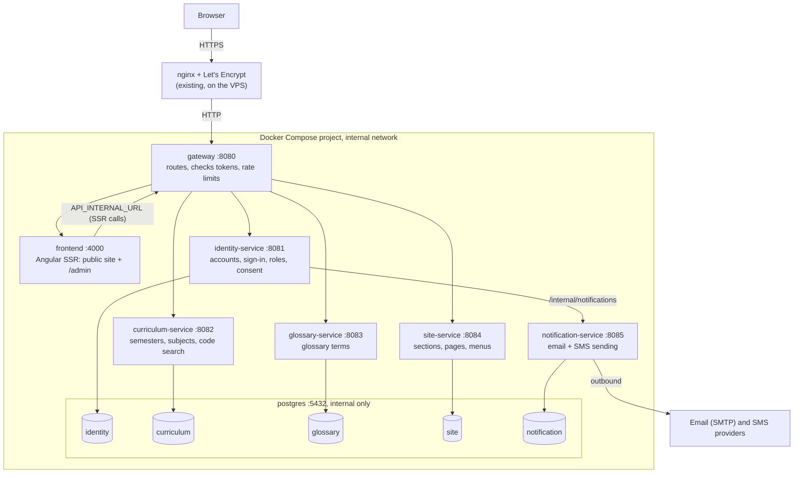

# BA.LLB Learning Portal — Design

As of 2026-11-04 · Step 2 of 3 · Requirements: [requirements.md](./requirements.md) · Next: [tasks.md](./tasks.md)

**Approval:** Approved 2026-11-04. All Proposed choices were accepted and are now Agreed. Changed
2026-11-04: the staging row in Environments, approved 2026-11-04.

**Labels:** _Agreed_ = decided by the owner · _Proposed_ = Claude's design choice, awaiting approval ·
_Open_ = not decided. Every row ends with the requirement (`R…`) or constraint (`C…`) IDs it serves.

## Overview

The portal is one Angular SSR app and six Spring Boot services, each in its own folder at the repository
root (C8, C11). Students and visitors use the public site; admins use a private dashboard inside the same
Angular app. Content services store Markdown in their own databases and return cleaned HTML. An identity
service owns all accounts and sign-in. nginx on the VPS talks only to the gateway (C6).

## Architecture



A page load: browser → nginx → gateway → `frontend`. During SSR the frontend calls the gateway at
`API_INTERNAL_URL` for data, renders HTML and returns it. After hydration the browser calls `/api/...`
on the public domain, through the same path.

## Decisions

| Decision         | Choice                                                                                                                                  | Why                                                                                             | Status | Serves                  |
| ---------------- | --------------------------------------------------------------------------------------------------------------------------------------- | ----------------------------------------------------------------------------------------------- | ------ | ----------------------- |
| Services         | gateway, identity, curriculum, glossary, site, notification                                                                             | One service per area of data: accounts, curriculum, glossary, site structure, outbound messages | Agreed | C2, C3                  |
| Admin dashboard  | Lazy-loaded `/admin` area inside the `frontend` app, rendered in the browser only                                                       | One app to build and deploy; private pages gain nothing from SSR or search engines              | Agreed | R8.1, C1                |
| Markdown to HTML | Each content service renders with flexmark-java, then cleans with OWASP Java HTML Sanitizer                                             | One cleaned output for every client; the browser bundle carries no Markdown parser              | Agreed | R6.3, C4                |
| Admin preview    | `POST /api/<service>/admin/preview` renders with the same code as live pages                                                            | The preview is exactly what students will see                                                   | Agreed | R9.5                    |
| Sign-in tokens   | identity-service issues a 15-minute signed access token (JWT) and a refresh token, both in `HttpOnly`, `Secure`, `SameSite=Lax` cookies | Works for SSR (the server forwards the cookie) and keeps tokens away from page scripts          | Agreed | R8.2, R11.4             |
| Token checks     | Gateway verifies the JWT against identity-service's public key and passes user ID and role to services in headers                       | One place checks tokens; services stay simple                                                   | Agreed | R8.3, R6.1              |
| SSO              | OpenID Connect through Spring Security OAuth2 Client in identity-service; providers set in config                                       | Adding a provider is configuration, not code                                                    | Agreed | R11.2                   |
| Mobile sign-in   | 6-digit one-time code by SMS, valid 5 minutes, 3 tries                                                                                  | Common, familiar pattern                                                                        | Agreed | R11.2                   |
| Disabled items   | An `enabled` flag on every content row; public endpoints return only enabled rows                                                       | Hide without deleting; admin views still list everything                                        | Agreed | R9.3, R9.4, R9.9, R10.5 |
| Freshness        | Services clear their HTML cache on every admin save; public `GET`s send `Cache-Control: max-age=60`                                     | Changes are visible within about a minute, inside the 5-minute limit                            | Agreed | R1.1, R9.2, R9.10       |
| Service calls    | Plain REST over the internal network; `/internal/**` paths are never routed by the gateway                                              | Simple for one host; internal calls can't be reached from outside                               | Agreed | R6.2                    |
| Discovery        | Docker Compose DNS names (`curriculum-service:8082`); no Eureka or Consul                                                               | A fixed set of services on one host                                                             | Agreed | C2                      |
| Builds           | Each folder is its own project: Maven wrapper per service, npm/Nx in `frontend/`                                                        | Matches self-contained folders; each service builds and ships alone                             | Agreed | C8                      |
| Stack            | Spring Boot 4.0.9, Spring Cloud 2025.1.4, Java 17, PostgreSQL 17, Angular 21                                                            | Current stable releases; Java 17 matches the local JDK                                          | Agreed | C1, C2                  |

## Components

| Component    | Folder                  | Port                | Owns              | Responsibilities                                                                                                                                         | Serves                              |
| ------------ | ----------------------- | ------------------- | ----------------- | -------------------------------------------------------------------------------------------------------------------------------------------------------- | ----------------------------------- |
| Frontend     | `frontend/`             | 4000 (dev 4200)     | Nothing           | Public pages with SSR, search box, account pages, `/admin` dashboard, language toggle                                                                    | R2–R5, R8.1, R9.5–R9.7, R12, C1, C9 |
| Gateway      | `gateway/`              | 8080                | Nothing           | Routes `/api/<service>/**` and `/**` (frontend); verifies tokens; rate-limits sign-in and search; adds security headers                                  | R6.1, R8.3, R11.6                   |
| Identity     | `identity-service/`     | 8081                | `identity` DB     | Users, roles, sign-up and sign-in (password, mobile code, SSO), lockout, sessions, password reset, profile, consent, account deletion, first super admin | R8.2–R8.10, R11                     |
| Curriculum   | `curriculum-service/`   | 8082                | `curriculum` DB   | Semesters, subjects, subject content, code and title search, admin CRUD, audit                                                                           | R1, R2, R9, R12                     |
| Glossary     | `glossary-service/`     | 8083                | `glossary` DB     | Glossary terms, admin CRUD, audit                                                                                                                        | R1, R3, R9                          |
| Site         | `site-service/`         | 8084                | `site` DB         | Sections, section pages, menus, reserved addresses, admin CRUD, audit                                                                                    | R9, R10                             |
| Notification | `notification-service/` | 8085                | `notification` DB | Sends email and SMS through providers; short delivery log                                                                                                | R11.3, R11.5                        |
| Postgres     | (image)                 | 5432, internal only | Data              | One database and one user per service                                                                                                                    | C3                                  |

## Data model

Every content table has `enabled` (boolean, default true), `sort_order`, `created_at`, `updated_at` and
`updated_by` (admin user ID). Text students read has `_en` (required) and `_hi` (optional) columns;
Markdown columns end in `_md`. Each content service also has an `audit_log` table: `id`, `entity`,
`entity_id`, `action` (`create`/`update`/`disable`/`enable`), `admin_id`, `at` (R9.8).

### identity

| Table           | Key columns                                                                                                                                                                                                                                                                              | Notes                                                                   |
| --------------- | ---------------------------------------------------------------------------------------------------------------------------------------------------------------------------------------------------------------------------------------------------------------------------------------- | ----------------------------------------------------------------------- |
| `app_user`      | `id`, `name`, `email` (unique, nullable), `mobile` (unique, nullable), `password_hash` (nullable), `role` (`student`/`editor`/`super_admin`), `enabled`, `email_verified`, `mobile_verified`, `marketing_consent`, `marketing_consent_at`, `failed_logins`, `locked_until`, `created_at` | No gender, age or religion columns (R11.9). Password hashed with bcrypt |
| `sso_identity`  | `user_id`, `provider`, `subject`                                                                                                                                                                                                                                                         | Links an SSO account to a user                                          |
| `one_time_code` | `id`, `user_id` or `destination`, `purpose` (`verify_email`/`verify_mobile`/`sign_in`/`reset_password`), `code_hash`, `expires_at`, `attempts`, `used_at`                                                                                                                                | Codes and reset links are stored hashed                                 |
| `refresh_token` | `id`, `user_id`, `token_hash`, `expires_at`, `last_used_at`                                                                                                                                                                                                                              | Admin tokens expire after 30 idle minutes (R8.10)                       |

### curriculum

| Table      | Key columns                                                                                                                                                                                                                             |
| ---------- | --------------------------------------------------------------------------------------------------------------------------------------------------------------------------------------------------------------------------------------- |
| `semester` | `number` (PK, 1–10), `year` (1–5), `note_md_en`, `note_md_hi`                                                                                                                                                                           |
| `subject`  | `id`, `code` (unique, URL key), `semester_number`, `title_en`, `title_hi`, `category`, `source` (`official`/`sample`), `paper`, `optional`, `practical`, `credits`, `max_marks`, `summary_en`, `summary_hi`, `body_md_en`, `body_md_hi` |

### glossary

| Table           | Key columns                                                                                 |
| --------------- | ------------------------------------------------------------------------------------------- |
| `glossary_term` | `id`, `slug` (unique), `term`, `meaning_md_en`, `meaning_md_hi`, `context_en`, `context_hi` |

### site

| Table           | Key columns                                                                                            | Notes                                                                                                      |
| --------------- | ------------------------------------------------------------------------------------------------------ | ---------------------------------------------------------------------------------------------------------- |
| `section`       | `id`, `slug` (unique), `title_en`, `title_hi`, `intro_md_en`, `intro_md_hi`                            | Published at `/{slug}` (R10.1)                                                                             |
| `page`          | `id`, `section_id`, `slug` (unique within section), `title_en`, `title_hi`, `body_md_en`, `body_md_hi` | Published at `/{section}/{page}` (R10.2)                                                                   |
| `menu_item`     | `id`, `label_en`, `label_hi`, `target_type` (`builtin`/`section`/`page`/`url`), `target_ref`           | One main menu (R10.3, R10.4)                                                                               |
| `reserved_slug` | `slug`                                                                                                 | Seeded with `semesters`, `glossary`, `admin`, `account`, `api`, `search`; sections can't use these (R10.6) |

### notification

| Table          | Key columns                                                                            | Notes                                                                                                 |
| -------------- | -------------------------------------------------------------------------------------- | ----------------------------------------------------------------------------------------------------- |
| `delivery_log` | `id`, `channel` (`email`/`sms`), `destination_masked`, `template`, `status`, `sent_at` | Destinations masked (`s***@gmail.com`); rows deleted after 30 days, so no personal data stays (R11.8) |

**Starting content:** a one-time script reads the prototype's `.data.ts` files and writes Flyway seed
migrations for curriculum and glossary, so nothing is lost at launch (R1.3).

## Interfaces

All public endpoints are read-only `GET`s; admin endpoints need a signed-in editor or super admin; errors
use RFC 9457 problem details (`application/problem+json`).

| Endpoint                                                      | Who                 | Purpose                                                                         | Serves               |
| ------------------------------------------------------------- | ------------------- | ------------------------------------------------------------------------------- | -------------------- |
| `GET /api/curriculum/years`                                   | Anyone              | Years with semesters and subject counts                                         | R2.1                 |
| `GET /api/curriculum/semesters/{number}`                      | Anyone              | Semester note and subject cards                                                 | R2.2                 |
| `GET /api/curriculum/subjects/{code}`                         | Anyone              | Subject details and rendered HTML                                               | R2.3                 |
| `GET /api/curriculum/search?q=`                               | Anyone              | Up to 10 subjects matching code or title, enabled only                          | R12                  |
| `GET /api/glossary/terms`                                     | Anyone              | All enabled terms with rendered meanings                                        | R3.1                 |
| `GET /api/site/menu`                                          | Anyone              | The main menu, without disabled items or items pointing at disabled sections    | R10.3, R10.7         |
| `GET /api/site/sections/{slug}` and `.../{slug}/pages/{page}` | Anyone              | Section and page content                                                        | R10.1, R10.2         |
| `/api/<service>/admin/**`                                     | Editor, super admin | Create, update, enable, disable, reorder, preview                               | R9, R10              |
| `/api/identity/auth/**`                                       | Anyone              | Sign up, sign in (password, mobile code, SSO), sign out, verify, reset password | R11.2–R11.6          |
| `/api/identity/me`                                            | Signed in           | View and edit profile and consent; delete account                               | R11.7, R11.8, R11.10 |
| `/api/identity/admin/users/**`                                | Super admin         | Manage admins and roles; disable any account                                    | R8.4–R8.6, R11.11    |

Text in two languages is returned as `{ "en": "...", "hi": "..." | null }`. Example:

```json
{
  "code": "1078204",
  "semester": 10,
  "title": { "en": "...", "hi": null },
  "category": "Law",
  "source": "official",
  "html": { "en": "<h2>Unit 1: ...</h2>...", "hi": null },
  "updatedAt": "2026-11-04T10:00:00Z"
}
```

### Sign-in with a password

```mermaid
sequenceDiagram
    participant B as Browser
    participant G as gateway
    participant I as identity-service
    B->>G: POST /api/identity/auth/sign-in (email, password)
    G->>I: forward (rate limited)
    I->>I: check lockout, verify bcrypt hash
    alt correct
        I-->>B: 200 + access and refresh cookies
    else wrong
        I->>I: count failure; 5 in 15 min locks for 15 min
        I-->>B: 401 problem details
    end
```

## Frontend

| Area      | Design                                                                                                                                                           | Serves      |
| --------- | ---------------------------------------------------------------------------------------------------------------------------------------------------------------- | ----------- |
| Rendering | `RenderMode.Server` for public routes; `RenderMode.Client` for `/admin/**` and `/account/**`                                                                     | R5.1, C1    |
| Hydration | `provideClientHydration(withHttpTransferCacheOptions(), withEventReplay())`; `HTTP_TRANSFER_CACHE_ORIGIN_MAP` maps the internal API origin to the public one     | R5.2, R5.3  |
| Language  | Saved in a `ballb.lang` cookie as well as `localStorage`; SSR reads the cookie and renders in that language; the `tr` pipe stays                                 | R4.1, R4.2  |
| Routes    | Built-in routes first (`/`, `/semesters/...`, `/glossary`, `/account/...`, `/admin/...`), then `/:section` and `/:section/:page` for admin sections              | R2.5, R10.1 |
| Menu      | Loaded from `GET /api/site/menu` during SSR                                                                                                                      | R10.3       |
| Search    | Header search box; debounced calls to `/api/curriculum/search`; an exact single-code match opens the subject                                                     | R12.1–R12.5 |
| Not found | Unknown semester, subject, section or page shows Not found, and SSR returns 404 through `RESPONSE_INIT`                                                          | R2.4        |
| Admin     | Lists, edit forms with English and Hindi side by side, Markdown editor with server preview, enable/disable toggles, drag to reorder; super admins also see Users | R8, R9, R10 |

## Error handling

| Situation                                | Behaviour                                                              | Serves      |
| ---------------------------------------- | ---------------------------------------------------------------------- | ----------- |
| Unknown page or code                     | 404 page; API returns 404 problem details                              | R2.4        |
| Required field missing on save           | 400 problem details listing the fields; the form highlights them       | R9.7        |
| Section address already used or reserved | 409 problem details naming the item that uses it                       | R10.6       |
| Too many failed sign-ins                 | 429 with the time the block ends                                       | R8.9, R11.6 |
| Expired or used reset link or code       | 410 with a "request a new one" link                                    | R11.5       |
| A service is down                        | Gateway returns 503; the page shows a retry message and keeps the menu | R5.1        |

## Environments and deployment

| Environment | Where                                                                                                                       | How it runs                                                                                                                                     | Entry                      | Serves   |
| ----------- | --------------------------------------------------------------------------------------------------------------------------- | ----------------------------------------------------------------------------------------------------------------------------------------------- | -------------------------- | -------- |
| dev         | Laptop                                                                                                                      | `frontend` with `nx serve`; services with `./mvnw spring-boot:run`; Postgres and Mailpit (fake email inbox) via `docker/docker-compose.dev.yml` | `http://localhost:4200`    | R7.1     |
| test        | Laptop                                                                                                                      | `docker compose -f docker/docker-compose.test.yml up` builds and runs everything                                                                | `http://localhost:8080`    | R7.2     |
| staging     | Staging host (Docker, no Docker in Docker, see [staging server spec](../staging-server/requirements.md)) | Compose project `ballb-staging` on the staging host's Docker, images from GitHub Container Registry (GHCR), behind its nginx-proxy      | `https://staging.<domain>` | R7.3, C5 |
| prod        | VPS                                                                                                                         | Compose project `ballb-prod`                                                                                                                    | `https://<domain>`         | R7.4, C5 |

GitHub Actions (C7, C10): `ci.yml` on pull requests builds and tests only the folders that changed;
`deploy-staging.yml` on merge to `main` builds changed images, tags them with the commit SHA and
redeploys staging (R7.5); `deploy-prod.yml` on an approved `v*` tag re-tags the staging-tested images and
deploys production (R7.6). Flyway runs each service's migrations at startup. The GitHub Pages workflow
is retired once staging is live.

## Repository layout

```text
ballb/
├── frontend/              Angular SSR app (moved from the root, C9)
├── gateway/
├── identity-service/
├── curriculum-service/
├── glossary-service/
├── site-service/
├── notification-service/
├── docker/                docker-compose.dev.yml, .test.yml, .vps.yml, postgres/init/   (C12)
├── docs/specs/            specs                                                        (C12)
├── tools/content-export/  one-time prototype content export
├── .github/workflows/     (C10)
└── CLAUDE.md, README.md
```

## Testing

| Level       | What                                                                                                                  | Serves                   |
| ----------- | --------------------------------------------------------------------------------------------------------------------- | ------------------------ |
| Unit        | Markdown rendering and cleaning; search matching; lockout and code expiry rules                                       | R6.3, R12.2, R8.9, R11.5 |
| Integration | Each service's API against a real Postgres (Testcontainers)                                                           | R2, R3, R9–R12           |
| End to end  | In the test environment: browse, search, switch language, sign up and in, admin edits a subject and a student sees it | R1.1, R4, R7.2, R9.10    |
| Checks      | SSR HTML contains content (`curl` a page); disabled items never appear publicly                                       | R5.1, R9.3               |

## Requirement coverage

| IDs          | Met by                                                                                                |
| ------------ | ----------------------------------------------------------------------------------------------------- |
| R1.1–R1.3    | Freshness decision; content services; content export script                                           |
| R2.1–R2.5    | Curriculum endpoints; frontend routes; Not found handling                                             |
| R3.1–R3.2    | Glossary endpoint; client-side filtering in the glossary page                                         |
| R4.1–R4.2    | Language cookie and `tr` pipe                                                                         |
| R5.1–R5.3    | SSR, hydration and transfer cache                                                                     |
| R6.1–R6.4    | nginx → gateway only; `/internal/**` not routed; sanitizer; HTTPS via existing Let's Encrypt          |
| R7.1–R7.6    | Environments and deployment                                                                           |
| R8.1–R8.10   | `/admin` area; identity roles and tokens; first super admin from environment variables on first start |
| R9.1–R9.10   | Admin endpoints; `enabled` flag; preview; audit log; freshness                                        |
| R10.1–R10.7  | site-service; reserved addresses; menu filtering                                                      |
| R11.1–R11.12 | identity-service; notification-service; public endpoints need no sign-in                              |
| R12.1–R12.6  | Curriculum search endpoint; header search box                                                         |
| C1–C12       | Architecture, components, builds and repository layout                                                |

## Open questions

- [ ] SSO providers: Google first, then others? (R11.2)
- [ ] SMS provider for one-time codes, and accepting its per-message cost. (R11.2)
- [ ] Email provider for production (for example an SMTP service). (R11.3, R11.5)
- [ ] Users under 18 and the Digital Personal Data Protection Act, 2023: block, or parental consent? Needs legal advice. (R11.1)
- [ ] Java 17 (matches your JDK) or Java 21 (newer LTS)?
- [ ] Production domain name. (R7.3, R7.4)
- [ ] Can admins permanently delete content, or only disable it? The design assumes disable only.
- [ ] Do sections need more than Markdown pages (uploaded PDFs or images)? The design assumes pages only.
