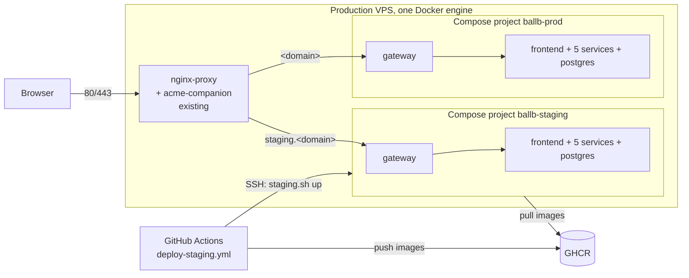

# Staging Server — Design

As of 2026-11-04 · Requirements: [requirements.md](./requirements.md) · Tasks: [tasks.md](./tasks.md)

**Approval:** Waiting for review.

**Labels:** _Agreed_ = decided · _Proposed_ = suggestion, not confirmed · _Open_ = not decided, ask first.

## Overview

Staging is a second Docker Compose project, `ballb-staging`, on the production VPS. It uses the same
`docker/docker-compose.vps.yml` as production, with a different project name, settings file and
image tag. Only its gateway joins the network of the existing nginx-proxy, and it carries
`VIRTUAL_HOST` and `LETSENCRYPT_HOST` set to `staging.<domain>`. nginx-proxy then routes the subdomain to
it, and acme-companion gets and renews its certificate. Compose prefixes every staging volume and
internal network with `ballb-staging`, so staging never shares data with `ballb-prod`. A small script,
`docker/staging/staging.sh`, gives one command each for up, down, rebuild and status, and GitHub Actions
runs it over SSH on every merge to `main`.

## Architecture



The proxy network (`proxy` in the diagram) connects nginx-proxy to the two gateways only. Each project's
other containers sit on that project's own internal network.

## Decisions

| Decision           | Choice                                                                                                                             | Why                                                                                  | Status   |
| ------------------ | ---------------------------------------------------------------------------------------------------------------------------------- | ------------------------------------------------------------------------------------ | -------- |
| Compose file       | Reuse `docker/docker-compose.vps.yml`; staging and production differ only in their env file and project name                       | R4.1: staging must run what production runs                                          | Agreed   |
| Project name       | `-p ballb-staging`, always passed by `staging.sh`                                                                                  | Compose namespaces containers, volumes and networks by project name (R1.5, R4.5)     | Agreed   |
| No fixed names     | `docker-compose.vps.yml` sets no `container_name` and publishes no host ports                                                      | Fixed names or ports would clash between the two projects (R1.5); nginx is the only entry (R2.1) | Proposed |
| Routing            | Gateway env `VIRTUAL_HOST=${PUBLIC_HOST}`, `VIRTUAL_PORT=8080`, `LETSENCRYPT_HOST=${PUBLIC_HOST}`; no other service gets them      | nginx-proxy and acme-companion find it on their own (R2.2, R2.4, R3.1, R4.3)         | Agreed   |
| Networks           | `internal` (per project) for all services; the gateway also joins the external proxy network named by `${PROXY_NETWORK}`            | Only the gateway can be reached by nginx (R2.4, R4.5)                                | Agreed   |
| Restart            | `restart: unless-stopped` on every service                                                                                          | Containers come back after a VPS reboot; `staging.sh down` keeps them down (R1.2)    | Proposed |
| Settings           | `docker/staging/staging.env.example` in the repo (no secrets); the real file is `/opt/ballb/staging/.env` on the VPS, created by hand | Secrets are never committed; staging secrets differ from production's (R4.5)         | Proposed |
| Files on the VPS   | `/opt/ballb/staging/` holds `docker-compose.vps.yml`, `staging.sh` and `.env`; production keeps `/opt/ballb/prod/`                  | Separate folders, so a staging deploy never overwrites production files (R1.5)       | Proposed |
| Memory limits      | `mem_limit` per staging container: services and gateway 384m, frontend 256m, postgres 512m (about 2.7 GB in all)                    | Staging can't starve production on the shared VPS (R1.5)                              | Proposed |
| Deploy             | `deploy-staging.yml` builds and pushes images tagged with the commit SHA, then SSHes in and runs `IMAGE_TAG=<sha> ./staging.sh up` | One path for every merge to `main` (R4.4, project R7.5)                              | Agreed   |
| Deploy access      | SSH key in the GitHub environment `staging` (`VPS_HOST`, `VPS_USER`, `VPS_SSH_KEY`); the user may only run Docker and write `/opt/ballb/staging` | Smallest access needed for the deploy                                                | Proposed |

## Components

| Component                             | Responsibility                                                                                                      | Covers                         |
| ------------------------------------- | ------------------------------------------------------------------------------------------------------------------- | ------------------------------ |
| Existing nginx-proxy + acme-companion | Unchanged. Routes by host name, redirects HTTP to HTTPS, ends SSL, gets and renews Let's Encrypt certificates       | C2–C4, R2.1, R2.3, R2.5, R3    |
| `docker/docker-compose.vps.yml`       | The portal stack for both projects: settings come from env vars, no fixed names, no host ports, memory limits        | C1, C5, R1.2, R1.3, R4.1, R4.3 |
| `docker/staging/staging.env.example`  | Lists every staging setting with a placeholder value                                                                | R4.2, R4.5                     |
| `docker/staging/staging.sh`           | `up` (pull + `up -d`), `down`, `rebuild` (`down -v` + `up -d`), `status`; always `-p ballb-staging`; refuses any other project name | R1.1, R1.4, R1.5               |
| `.github/workflows/deploy-staging.yml` | On merge to `main`: build, push to GHCR, copy files to `/opt/ballb/staging/`, run `staging.sh up`, check health       | R4.4                           |

## Interfaces

Settings file (`/opt/ballb/staging/.env`, from `staging.env.example`):

```dotenv
COMPOSE_PROJECT_NAME=ballb-staging
PUBLIC_HOST=staging.example.in
PROXY_NETWORK=nginx-proxy
IMAGE_TAG=latest
POSTGRES_PASSWORD=change-me
JWT_PRIVATE_KEY_FILE=/opt/ballb/staging/secrets/jwt.pem
```

Gateway service in `docker-compose.vps.yml`:

```yaml
gateway:
  image: ghcr.io/iiitrke/ballb-gateway:${IMAGE_TAG}
  restart: unless-stopped
  mem_limit: 384m
  environment:
    VIRTUAL_HOST: ${PUBLIC_HOST}
    VIRTUAL_PORT: "8080"
    LETSENCRYPT_HOST: ${PUBLIC_HOST}
  networks: [internal, proxy]

networks:
  internal: {}
  proxy:
    external: true
    name: ${PROXY_NETWORK}
```

Commands on the VPS:

```sh
cd /opt/ballb/staging
./staging.sh up        # start or update staging
./staging.sh down      # stop staging; production keeps running
./staging.sh rebuild   # delete staging data and start fresh
./staging.sh status    # list staging containers
```

## Error handling

| Failure                                           | What happens                                                                                       | Covers |
| ------------------------------------------------- | -------------------------------------------------------------------------------------------------- | ------ |
| `.env` missing or a setting is empty              | `staging.sh` stops before calling Docker and names the missing setting                              | R1.5   |
| Project name is not `ballb-staging`               | `staging.sh` refuses to run, so it can never touch `ballb-prod`                                     | R1.5   |
| Proxy network not found                           | Compose fails to start the gateway; `staging.sh` prints the network names that exist                | R2.2   |
| A new image fails its health check after deploy   | The workflow fails and shows the container logs; the previous containers stay stopped (staging only) | R4.4   |
| Let's Encrypt can't issue the certificate         | acme-companion retries; nginx-proxy serves its default certificate meanwhile; production unaffected | R3.1   |

## Testing

| Check                                                                                                         | Covers           |
| ------------------------------------------------------------------------------------------------------------- | ---------------- |
| `curl -I http://staging.<domain>` returns `301` to `https://`                                                  | R2.5             |
| `curl -fsS https://staging.<domain>/actuator/health` returns `{"status":"UP"}`                                 | R2.2, R4.2       |
| `openssl s_client -connect staging.<domain>:443` shows issuer Let's Encrypt                                    | R3.1, R3.2       |
| Production container IDs (`docker ps -q --filter label=com.docker.compose.project=ballb-prod`) are the same before and after `staging.sh up`, `down` and `rebuild` | R1.5 |
| `docker network inspect ${PROXY_NETWORK}` lists only the two gateways from the portal                          | R2.4, R4.5       |
| After `staging.sh down`, `https://<domain>` still answers                                                      | R2.3, R1.5       |
| After a VPS reboot, `staging.sh status` shows every container running                                         | R1.2             |
| After `staging.sh up` twice, staging data is still there                                                       | R1.3             |
| A merge to `main` ends with the new SHA running on staging                                                     | R4.4             |

## Open questions

- [ ] The real domain (project open question). `PUBLIC_HOST` is `staging.<domain>`.
- [ ] The name of the existing nginx-proxy network on the VPS (`docker network ls`), for `PROXY_NETWORK`.
- [ ] Does acme-companion have `DEFAULT_EMAIL` set? If not, the gateway also needs `LETSENCRYPT_EMAIL`.
- [ ] Does production already run from `/opt/ballb/prod/`, or somewhere else?
